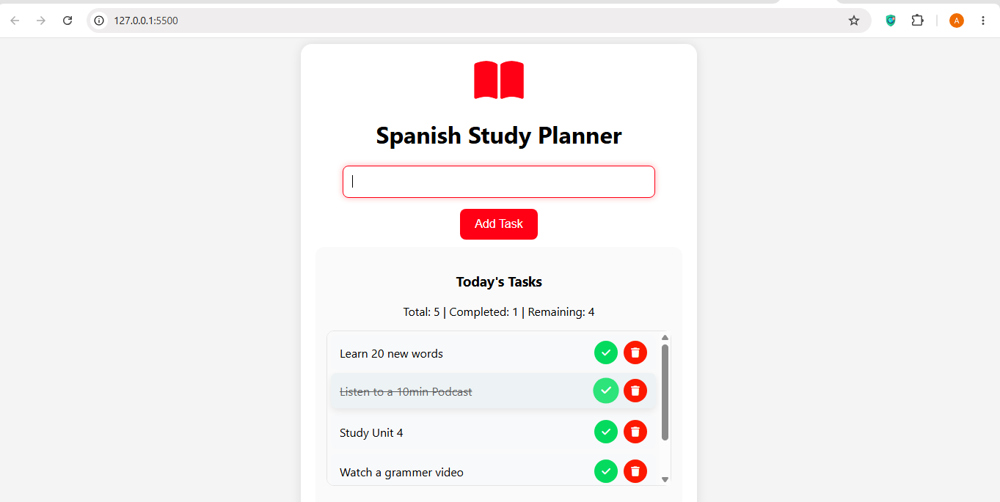

# 🇪🇸 Spanish Study Planner

A simple and interactive web application for organizing daily Spanish learning tasks.

This project started as a beginner-friendly JavaScript exercise and gradually evolved into a practical task management application.

## 🚀 Live Demos

| Version | Description | Live Demo |
|---|---|---|
| v1.0 | Basic Task Management | [View v1.0](https://alighofrantalab.github.io/Spanish-Study-Planner/v1.0/) |
| v1.1 | Improved UI & Task Management | [View v1.1](https://alighofrantalab.github.io/Spanish-Study-Planner/v1.1/) |
| v1.2 | Enhanced Task Management & Local Storage | [View v1.2](https://alighofrantalab.github.io/Spanish-Study-Planner/v1.2/) |

## ✨ Features

- Add new study tasks
- Edit existing tasks
- Mark tasks as completed
- Delete tasks
- Press Enter to add tasks quickly
- Automatic task numbering
- Task counters (Total, Completed, Remaining)
- Save tasks using Local Storage
- Scrollable task list

## 🛠️ Built With

- HTML5
- CSS3
- Vanilla JavaScript (ES6)
- Browser Local Storage
- Font Awesome

## 📚 What I Learned

- DOM manipulation
- Event handling
- Creating and updating HTML elements dynamically
- Working with arrays and objects
- Managing application state
- Using Local Storage
- Building interactive user interfaces

## 📸 Preview

## 🧭 Version History

- **v1.0:** Initial release with basic task management.
- **v1.1:** Improved interface, task completion, deletion, and counters.
- **v1.2:** Task editing, completion, deletion, counters, and Local Storage support.

## 🔮 Future Improvements

- Dark Mode
- Spanish study categories (Vocabulary, Grammar, Listening, Speaking)
- Daily learning goals
- Progress bar
- Statistics dashboard
- Further UI improvements

## 👨‍💻 Author

**Ali Ghofrantalab**

[GitHub Profile](https://github.com/AliGhofrantalab)

---

*Created for learning and portfolio purposes.*